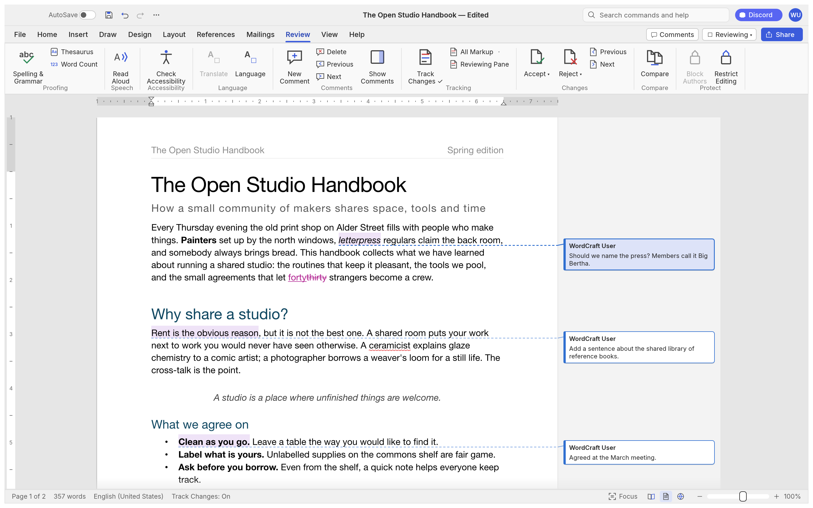
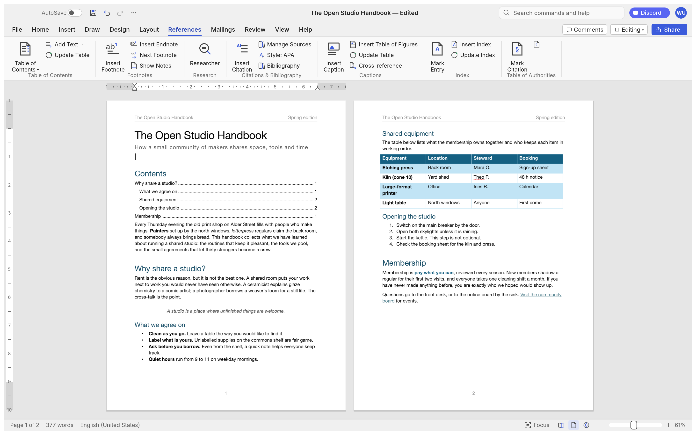
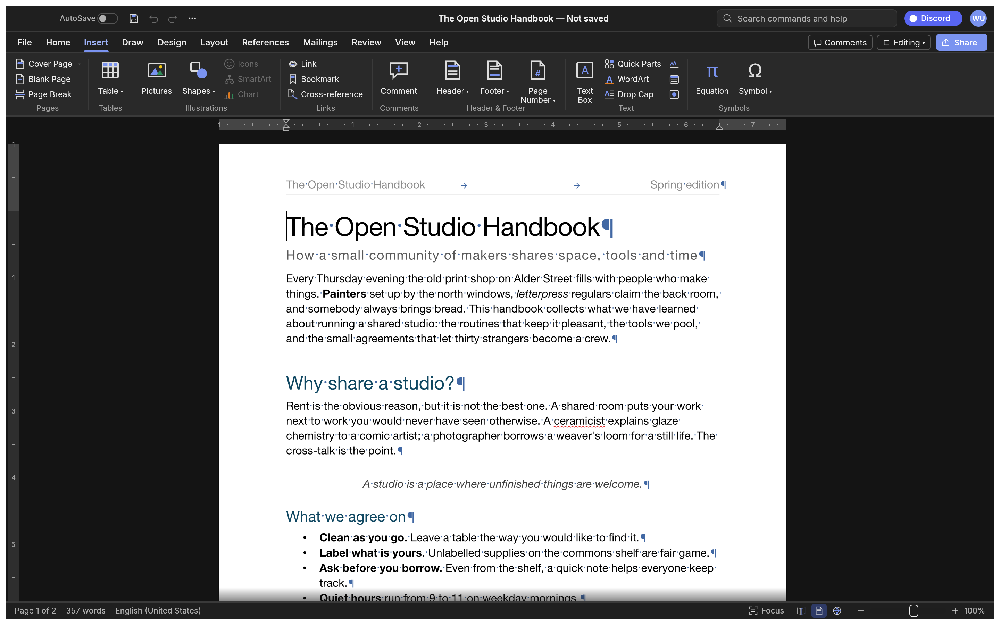

<h1 align="center">MarkdownDocs</h1>

<p align="center">
  <b>A document editor built for AI agents first: Markdown as the native working format, DOCX and
  other formats as first-class citizens too.</b>
</p>

<p align="center">
  One tool for every document an agent (or a person) needs to read, edit or produce: Markdown
  natively, .docx with real fidelity, plus .odt, .rtf, .html, .md, .tex, .txt. Scriptable end to
  end — CLI, a JSON control protocol, an MCP server — runs natively on macOS, Windows, Linux and
  BSD, and in the browser via WebAssembly.<br>
  <i>A fork of <a href="https://github.com/storytold/wordcraft">WordCraft</a>.</i>
</p>

<p align="center">
  
  
  
  
  
</p>

<br>

<p align="center">
  
  <br><sub>The ribbon, live Styles gallery, rulers and the Navigation pane — inherited from WordCraft, kept working while this fork's own priorities (Markdown-native, agent-first) build out.</sub>
</p>

> [!NOTE]
> **This is a fork, not the original project.** It diverges from
> [storytold/wordcraft](https://github.com/storytold/wordcraft) in purpose — agents first, not a
> human-facing Word replacement — and will diverge further in code over time. See
> [AGENTS.md](AGENTS.md) for why, and the [License and credits](#license-and-credits) section below
> for the full attribution.

<p align="center">
  <a href="#a-tour">A tour</a> ·
  <a href="#why-markdowndocs">Why MarkdownDocs</a> ·
  <a href="#what-works-today">What works today</a> ·
  <a href="#quick-start">Quick start</a> ·
  <a href="#for-agents-cli-and-mcp">For agents</a> ·
  <a href="#architecture">Architecture</a> ·
  <a href="#roadmap">Roadmap</a> ·
  <a href="#contributing">Contributing</a> ·
  <a href="#license-and-credits">License and credits</a>
</p>

## A tour

Every screenshot below is WordCraft itself, rendered offscreen by its own UI test harness
(`cargo run -p wordcraft-ui-egui --example ui_shot`).

<table>
<tr>
<td width="50%" valign="top"><p align="center"><sub><b>Review.</b> Track changes, comment balloons in the margin, accept and reject, spelling and grammar as you type.</sub></p></td>
<td width="50%" valign="top"><p align="center"><sub><b>References.</b> Tables of contents, footnotes, citations in APA, MLA, Chicago or IEEE, index and captions.</sub></p></td>
</tr>
<tr>
<td width="50%" valign="top"><p align="center"><sub><b>Design.</b> Themes, style sets, paragraph spacing, watermarks, page colour and borders.</sub></p></td>
<td width="50%" valign="top"><p align="center"><sub><b>Dark mode</b> with formatting marks, and the Insert tab: tables, pictures, shapes, links, headers, footers, fields and symbols.</sub></p></td>
</tr>
<tr>
<td colspan="2"><p align="center"><sub><b>Layout.</b> Drop caps, text wrapping around pictures and shapes, automatic hyphenation, line numbers and page borders.</sub></p></td>
</tr>
<tr>
<td colspan="2"><p align="center"><sub><b>File.</b> Start from a template, open recent documents, edit properties, export to PDF and other formats.</sub></p></td>
</tr>
</table>

## Why MarkdownDocs

- **Markdown-native.** Unlike most word processors (where Markdown, if supported at all, is a
  lossy one-way export), Markdown here is treated as a format that keeps everything a document
  needs for agent-driven editing — on par with .docx, not beneath it. AutoSave, round-trip fidelity
  and ongoing work all treat `.md` as first-class.
- **Built for agents, first.** Every action is a command with a stable id and JSON params. The same
  commands drive the ribbon, keyboard shortcuts, the command search, a command-line tool, a JSON
  control channel and an MCP server — an agent never has to screen-scrape a GUI to get work done.
- **Your files, many formats.** Opens and saves .docx (OOXML), and also .odt, .rtf, .html, .md,
  .tex (LaTeX), .txt; opens legacy 97-2003 .doc; exports PDF with real, selectable text, links and
  bookmarks.
- **Still familiar when a human's driving.** Ribbon tabs, groups, shortcuts and behaviour: Enter
  continues a list, Tab demotes it, Ctrl/⌘+B bolds the word under the caret, F4 repeats, F7 checks
  spelling — inherited from WordCraft's Word-parity work, kept working.
- **Fast.** Paragraph layout is cached, so typing in a 188-page document re-lays it out in about
  1.4 ms; pages render on demand.
- **Everywhere.** One Rust codebase for macOS, Windows, Linux, BSD and the web. No Electron, no
  Tauri: native [egui](https://github.com/emilk/egui) on the GPU.
- **Private.** Spelling, grammar and everything else work offline.
- **Open.** MIT OR Apache-2.0. Clean-room: built from public specifications and observation, with
  every asset original or openly licensed.

## What works today

| Area | Highlights |
|---|---|
| **Writing** | Fast typing with IME, smart quotes, AutoCorrect, list autoformat (`* `, `1. `), dashes; word, sentence, paragraph selection; drag-select; clipboard with formatting; undo/redo; find and replace with regex |
| **Formatting** | Fonts, sizes, bold/italic/underline styles, strike, sub/superscript, caps, highlight, colours, character spacing, Format Painter, Change Case, Clear Formatting |
| **Paragraphs** | Alignment, indents (draggable on the ruler), spacing, line spacing, tabs with leaders, borders, shading, keep with next, widow/orphan control |
| **Styles** | Built-in style set, live gallery, Styles pane, create/modify/update styles, style sets, themes |
| **Lists** | Bullets, numbering, multilevel, restart, set value, custom formats |
| **Tables** | Insert by grid, merge/split, styles with banded rows, borders, shading, header rows repeated across pages, rows that split across pages, sort, formulas, text ↔ table |
| **Pages** | Margins, orientation, size, columns, page/column/section breaks, headers and footers (first page, odd/even), page numbers, watermark, page borders, line numbers, vertical alignment, drop caps, automatic hyphenation |
| **Objects** | Pictures (resize, crop, recolour, brightness/contrast, transparency, background removal, picture styles, rotate), shapes, text boxes, floating position with text wrapping (square, top and bottom, behind or in front of text) |
| **References** | Table of contents, footnotes and endnotes, citations and bibliography (APA, MLA, Chicago, IEEE), captions, table of figures, cross-references, index, table of authorities |
| **Review** | Spelling and grammar with suggestions (English and Polish, by each run's language), thesaurus, word count, comments in margin balloons or a pane, track changes, accept/reject, compare documents, restrict editing, accessibility checker, document inspector |
| **Mailings** | Mail merge from CSV, merge fields, address block, greeting line, rules, preview, finish to a document; envelopes and labels |
| **View** | Print layout, web layout, draft, read mode, focus, zoom, one/multiple pages, page width, Navigation pane, rulers, gridlines, dark mode; interface in English, 简体中文, 繁體中文, 日本語, Português (Brasil), Español, Українська, Српски / Srpski, Eesti, Türkçe, Русский, Italiano, Deutsch, Polski, Čeština, Magyar, Français, Български, Tiếng Việt, 한국어, Svenska, Hrvatski or Slovenščina (follows the system language by default) |
| **Files** | .docx read/write, legacy 97-2003 .doc import, PDF export, .odt, .rtf, .html, .md, .tex, .txt import/export, page images |

The honest picture, area by area, is in [ROADMAP.md](ROADMAP.md), the
[parity assessment](docs/target-app-parity.md) and the generated
[feature checklist](docs/parity-checklist.md).

## Quick start

```sh
git clone https://github.com/MichaelMuClaude/MarkdownDocs
cd MarkdownDocs
cargo run --release -p wordcraft -- --sample        # the desktop app with the sample document
cargo run --release -p wordcraft -- report.md       # open a document
```

(The binaries are still named `wordcraft`/`wordcraft-cli`, inherited from the fork — not yet
renamed.)

Install it for your user on Linux, as `markdowndocs` and `markdowndocs-cli` with a launcher entry
in `~/.local` (rerun after pulling or changing the code; `--uninstall` removes it):

```sh
packaging/linux/install-local.sh
```

Command line:

```sh
wordcraft-cli convert report.docx report.pdf        # docx, pdf, odt, rtf, html, md, tex, txt, png
wordcraft-cli text report.docx                      # plain text
wordcraft-cli inspect report.docx                   # structure as JSON
wordcraft-cli run --template sample \
  --cmd 'select.text={"text":"Membership"}' --cmd format.bold --save out.docx
wordcraft-cli run --script job.json                 # the same from a file: commands, then save to docx and pdf
```

Web: `cd apps/wordcraft-web && trunk serve`, then open <http://127.0.0.1:8771/?sample>.

## For agents: CLI and MCP

This is the primary way MarkdownDocs is meant to be used: driven by an AI agent, not just a person
clicking a ribbon.

```sh
claude mcp add wordcraft -- wordcraft-cli mcp                  # headless documents
# confine the agent to folders: wordcraft-cli mcp --automation-read-root DIR --automation-write-root DIR
wordcraft --control 7981 &                                     # or drive the running app…
claude mcp add wordcraft-app -- wordcraft-cli mcp --connect 127.0.0.1:7981
```

Tools include `list_commands`, `execute`, `batch`, `type_text`, `select_text`, `inspect_document`,
`render_page`, `save_document`, and, with a running app, `screenshot`, `click` and `key`. Agents
can check their work through `inspect_document` without screenshots. See [docs/mcp.md](docs/mcp.md)
and the [control protocol](docs/control-protocol.md). Macros record any sequence of commands and
play it back (`tools.recordMacro`, `tools.macros`).

## Logs

The desktop app writes its log records to standard error and to `logs/wordcraft.log` next to its
preferences: on Linux `$XDG_CONFIG_HOME/markdowndocs/logs/` (by default `~/.config/markdowndocs/logs/`),
on macOS `~/Library/Application Support/MarkdownDocs/logs/`, on Windows `%APPDATA%\MarkdownDocs\logs\`.
A start from a desktop menu or the Dock has no terminal, so this file is what to attach to a bug
report: unreadable parts of a .docx, pictures or fonts a PDF export had to leave out and panics the
command guard recovered from land there. Each launch moves the previous log to `wordcraft.1.log`
(and that one to `wordcraft.2.log`), so the log of a run that crashed survives the next start; a
log stops growing at 16 MiB. `--version` writes no file, and runs with `WORDCRAFT_NO_PREFS` (agents'
test runs) log to standard error only. Document text is never logged; a panic message leaves out
the text it quotes.

By default WordCraft's own crates log at `info` and everything else at `warn`. `RUST_LOG` replaces
that with env_logger-style directives, for example `RUST_LOG=debug`,
`RUST_LOG=warn,wordcraft_docx=trace` or `RUST_LOG=info,wgpu_core=warn`; a directive ending in `*`
covers every target starting with it (`wordcraft*=debug`). The logger is
`apps/wordcraft/src/logging.rs`.

## Architecture

| Layer | Crate | Job |
|---|---|---|
| L0 | `wordcraft-geom` | units and measurements |
| L1 | `wordcraft-doc`, `wordcraft-fonts`, `wordcraft-proof` | document model and editing; fonts and shaping; spelling, grammar, hyphenation |
| L2 | `wordcraft-layout`, `wordcraft-docx`, `wordcraft-formats` | line breaking, pagination, tables, notes, hit testing; OOXML; ODT/RTF/HTML/Markdown/TXT |
| L3 | `wordcraft-render`, `wordcraft-pdf` | rasteriser (vello_cpu); PDF ([craft-pdf](docs/shared-pdf.md), Krilla) |
| L4 | `wordcraft-engine` | session, undo, 422 commands, document feature catalog |
| L5 | `wordcraft-mcp` | MCP server |
| L6 | `wordcraft-ui-egui` | the word processor front end (swappable) |
| apps | `wordcraft`, `wordcraft-cli`, `wordcraft-web` | desktop, command line, browser |

`cargo xtask ci` runs formatting, clippy, ~800 tests, the asset-attribution check, the layering
check and the wasm build. Contributor and agent instructions: [AGENTS.md](AGENTS.md).

## Roadmap

The inherited feature set (everything in the table above) is at WordCraft's own upstream
maturity — commands for 97% of the ribbon/menu feature catalog
([`docs/parity-checklist.md`](docs/parity-checklist.md)), roughly alpha-to-beta quality
depending on the area; see [ROADMAP.md](ROADMAP.md) and [docs/gaps.md](docs/gaps.md) for the
honest, inherited picture. This fork's *own* roadmap — Markdown fidelity closing the gap with
.docx, a sharper MCP/agent surface, and whatever else makes this genuinely good for agent use — is
still being written. Issues tagged for agent-use gaps are the best signal of current priorities.

## Building from source

No prebuilt downloads yet — build it yourself (see [Quick start](#quick-start) above for the
clone/run commands). Needs a recent stable [Rust toolchain](https://rustup.rs/). Platform-specific
build notes (Windows graphics backend overrides, Wayland, FreeBSD, etc.) are the same as upstream
WordCraft's — see [storytold/wordcraft's README](https://github.com/storytold/wordcraft#downloads)
if you hit a platform-specific snag; most of it applies unchanged here.

## Contributing

Issues and PRs are welcome — from people and from AI agents working on someone's behalf alike.
See [CONTRIBUTING.md](CONTRIBUTING.md) for the mechanics, and [AGENTS.md](AGENTS.md) for the
engineering standards this project holds itself to (never crash, clean-room formats, the layering
rules). The most valuable reports right now are anything specific to agent use: a command that's
awkward to drive programmatically, a Markdown round-trip that silently loses something, rough edges
in the MCP server or control protocol.

## License and credits

MarkdownDocs is an independent fork of [storytold/wordcraft](https://github.com/storytold/wordcraft),
not an official WordCraft or ArtCraft project, and isn't affiliated with, endorsed by or
supported by the ArtCraft team. Dual-licensed under [MIT](LICENSE-MIT) or
[Apache-2.0](LICENSE-APACHE), at your option, same as upstream. Copyright (c) 2026 ArtCraft Team
and the WordCraft contributors for the inherited code, and the MarkdownDocs contributors for
changes made here. Required notices are in [NOTICE](NOTICE).

Bundled fonts, icons, images and other assets keep their own open licenses; each one is listed
with its author, source and license in [ATTRIBUTION.md](ATTRIBUTION.md).

The English spelling dictionary and hyphenation come from Grady Ward's public-domain Moby
Hyphenator II word list. Polish spelling reads the Hunspell `pl_PL` dictionary installed on the system (not bundled), as
do Russian, Portuguese, Czech, Italian, Croatian and Turkish spelling (how to install them:
[docs/spelling-dictionaries.md](docs/spelling-dictionaries.md)), and
Polish hyphenation the TeX patterns by Hanna Kołodziejska, Bogusław Jackowski and Marek Ryćko (MIT
option). The sample documents and templates are original text inherited from WordCraft.

The ArtCraft name, wordmark and logos were trademarks of the ArtCraft Team, not covered by this
license, and have been removed from this fork per their terms
([`docs/brand/LICENSE-brand.txt`](docs/brand/LICENSE-brand.txt) in the
[upstream repository](https://github.com/storytold/wordcraft/blob/main/docs/brand/LICENSE-brand.txt),
since this fork no longer carries that file). This project has its own name and identity and makes
no claim to be ArtCraft or WordCraft.
